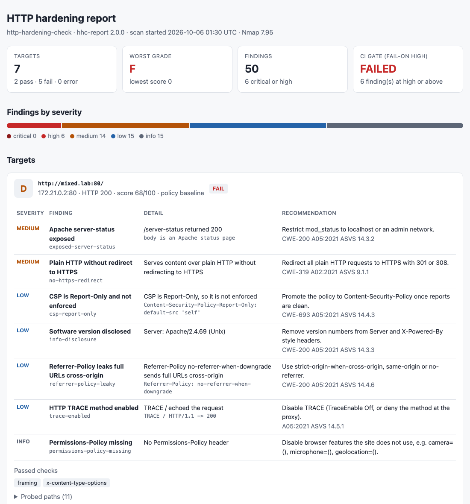
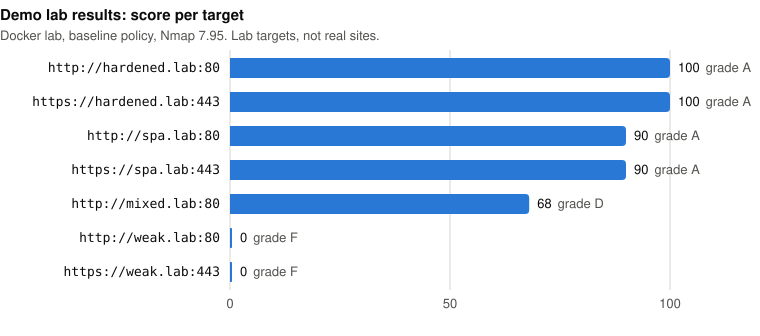
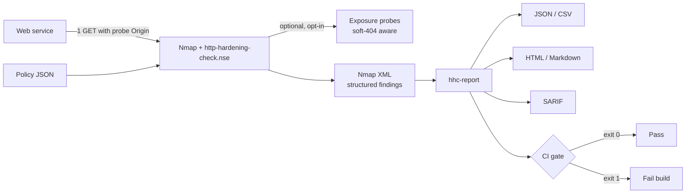

<h1> http-hardening-check</h1>

An Nmap script that audits HTTP security headers, cookies and CORS against a policy you control, scores each service from 0 to 100, and writes reports that can pass or fail a CI build.

[](https://github.com/VijaysinghPuwar/http-hardening-nmap-nse/actions/workflows/ci.yml)
[](https://github.com/VijaysinghPuwar/http-hardening-nmap-nse/tags)


[](LICENSE)

<picture>
  <source media="(prefers-color-scheme: dark)" srcset="docs/img/report-dark.png">
  
</picture>

<sub>HTML report written by `hhc-report` from the Docker demo lab. The lab targets are deliberately weak.</sub>

## In one minute

- **What it does.** Reads one page per port, judges the security headers it gets back, and reports each weakness with a severity, evidence and a fix.
- **Why it is different.** Nmap's built-in `http-security-headers` lists headers. This one grades them. A header that is present but useless, such as `HSTS: max-age=0`, is a finding here.
- **Where it fits.** Run it by hand, in a Docker lab, or as a GitHub Action that fails the build when a header regresses.
- **What is in the repo.** The Nmap script (Lua), a zero dependency Python reporter, three JSON policies, two labs, a GitHub Action, and 321 tests.

## Compared with Nmap's built-in script

| | `http-security-headers` (bundled) | `http-hardening-check` |
|---|---|---|
| Output | Header names and values | Findings with severity, evidence, fix and CWE/OWASP/ASVS reference |
| `HSTS: max-age=0` | Listed as present | `hsts-disabled` (MEDIUM). HSTS is switched off |
| CSP with `'unsafe-inline'` | Listed as present | `csp-unsafe-inline` (MEDIUM), unless a nonce or hash cancels it |
| HSTS on plain HTTP | Listed | Not required, because browsers ignore it. The missing redirect is the finding |
| Clickjacking | X-Frame-Options shown | CSP `frame-ancestors` and X-Frame-Options read together, the way browsers do |
| Policy, score, CI exit code | No | Policy files, 0 to 100 score and grade, `hhc-report --fail-on` |
| Regression tracking | No | `--baseline`, so only new findings fail the build |

Tests in [`tests/integration/test_differential.py`](tests/integration/test_differential.py) run both scripts side by side and check that every header the built-in one lists is either passed or judged here.

## Quickstart

The demo lab is a set of deliberately insecure containers on an isolated Docker network. Nothing is reachable from outside. You need Docker and `make`.

```bash
git clone https://github.com/VijaysinghPuwar/http-hardening-nmap-nse.git
cd http-hardening-nmap-nse
make demo        # build the lab, scan it, write reports to lab/docker/out/
open lab/docker/out/report.html   # or xdg-open
make lab-down
```

To scan a system you are authorized to test:

```bash
nmap -sV -p80,443 --script ./http-hardening-check.nse app.internal.example
nmap -sV -p443 --script ./http-hardening-check.nse \
  --script-args 'http-hardening-check.policy=policies/strict.json,http-hardening-check.vhost=app.internal.example' \
  -oX scan.xml 10.0.0.15
```

## Example result

Real output from the demo lab's `weak.lab` (nginx 1.27, Nmap 7.95):

```
443/tcp open  ssl/http nginx
| http-hardening-check:
|   url: https://weak.lab:443/ (200)
|   result: FAIL  score: 17/100  grade: F  policy: baseline
|   summary: critical=0 high=1 medium=4 low=6 info=6 (fail-on=medium)
|   HIGH     cors-reflected-credentials  Origin reflected in Access-Control-Allow-Origin with credentials allowed
|   MEDIUM   cookie-no-secure            Session cookie sent without Secure over HTTPS: PHPSESSID
|   MEDIUM   csp-broad-script-source     default-src allows scripts from *
|   MEDIUM   csp-unsafe-inline           default-src allows 'unsafe-inline' without a nonce or hash
|   MEDIUM   framing-allowed             X-Frame-Options ALLOW-FROM is ignored by current browsers
|   LOW      cookie-no-httponly          Session cookie readable by JavaScript: PHPSESSID
|   LOW      csp-no-object-src           default-src allows plugins from *
|   LOW      csp-unsafe-eval             default-src allows 'unsafe-eval'
|   LOW      hsts-short-max-age          max-age=300 is below 15768000
|   LOW      info-disclosure             Server: nginx/1.27.5
|   LOW      xcto-missing                X-Content-Type-Options is not nosniff
|   INFO     cookie-no-samesite          Session cookie without SameSite: PHPSESSID
|   INFO     csp-no-base-uri             CSP has no base-uri (it does not fall back to default-src)
|   INFO     hsts-no-subdomains          HSTS does not set includeSubDomains
|   INFO     permissions-policy-missing  No Permissions-Policy header
|   INFO     referrer-policy-missing     No Referrer-Policy; the browser default applies
|_  INFO     xxp-enabled                 X-XSS-Protection enables the removed XSS auditor
```

Every header on that site is present. A presence check would pass most of them.

## What it checks

| Area | Example findings | Notes |
|---|---|---|
| Transport, HSTS | `no-https-redirect`, `hsts-disabled`, `hsts-short-max-age`, `hsts-invalid` | HSTS judged only over TLS (RFC 6797) |
| CSP | `csp-unsafe-inline`, `csp-broad-script-source`, `csp-no-object-src`, `csp-report-only` | Handles nonces, hashes, `'strict-dynamic'`, `<meta>` CSP and multiple policies |
| Framing | `framing-missing`, `framing-allowed` | `frame-ancestors` overrides X-Frame-Options |
| Cookies | `cookie-no-secure`, `cookie-no-httponly`, `cookie-samesite-none-insecure` | Session cookies judged strictly. CSRF tokens may be script readable |
| CORS | `cors-reflected-credentials` (HIGH), `cors-reflected-origin` | Found with a harmless `Origin: https://hardening-check.invalid` |
| Other headers | `xcto-missing`, `referrer-policy-leaky`, `permissions-policy-permissive`, `info-disclosure` | Deprecated headers (HPKP, Expect-CT, X-XSS-Protection) are INFO |
| Exposure (opt in) | `exposed-git`, `exposed-env`, `exposed-server-status`, `directory-listing`, `trace-enabled` | Content signatures plus soft-404 detection. Response bodies are never copied into reports |

All 48 findings with severities and references: [docs/checks.md](docs/checks.md). Fixes: [nginx](docs/remediation/nginx.md), [Apache](docs/remediation/apache.md), [IIS](docs/remediation/iis.md), [Cloudflare](docs/remediation/cloudflare.md).

## Scoring

`score = 100 - (40 per critical + 25 per high + 10 per medium + 3 per low)`, floored at 0. Info findings cost nothing. Grades: A 90+, B 80+, C 70+, D 60+, F below. One high finding caps the grade at C, one critical caps it at F. PASS or FAIL is a separate decision made by the policy's `fail_on`. Details: [docs/scoring.md](docs/scoring.md).



## Policy as code

```json
{
  "name": "my-team",
  "fail_on": "medium",
  "hsts": {"min_max_age": 31536000, "require_include_subdomains": true},
  "exposure": {"enabled": true, "paths": ["/internal/metrics"]},
  "skip": ["info-disclosure"],
  "checks": {"csp-unsafe-eval": {"severity": "medium"}}
}
```

Presets: `baseline` (default), `strict`, `owasp-asvs-l1`. An unknown key, an unknown finding ID or a wrong type is rejected with `result: ERROR`, so a typo never quietly weakens a scan. Schema and precedence: [docs/policy.md](docs/policy.md).

## Reports and CI

`hhc-report` is a Python 3.10+ package with no dependencies. It reads Nmap XML:

```bash
pip install ./reporter
hhc-report scan.xml                                  # table; exit 1 if any target fails its policy
hhc-report scan.xml -o report.html                   # also .json .csv .md .sarif
hhc-report scan.xml --fail-on high                   # exit 1 only on high or critical
hhc-report scan.xml --baseline main.json             # only findings new since main.json fail
```

| Format | For |
|---|---|
| JSON | Automation. Stable schema (`reporter/src/hhc_report/report.schema.json`) |
| CSV | Spreadsheets and SIEM import. Formula injection neutralised |
| Markdown | Pull request comments, `$GITHUB_STEP_SUMMARY` |
| HTML | People. Self contained, no JavaScript, light and dark |
| SARIF 2.1.0 | Code scanning tools. Validated against the official schema |

Exit codes: `0` gate passed, `1` gate failed, `2` input error. Details: [docs/reporter.md](docs/reporter.md).

### GitHub Actions

```yaml
- uses: VijaysinghPuwar/http-hardening-nmap-nse@v2.0.0
  with:
    targets: staging.internal 10.0.4.20
    ports: "443"
    policy: strict
    fail-on: high
```

The action checks every input before it reaches a shell and refuses targets that resolve to public addresses unless `allow-public-targets: true` is set. It writes Markdown to the job summary and SARIF to `outputs.sarif-file`. The SARIF is validated against the schema, but uploading it to GitHub code scanning has not been tested.

## How it works



The evaluation engine inside the script is pure Lua with no network or Nmap state, so the unit tests load the same file with stub libraries and exercise it directly.

Request budget: one GET per port, plus up to three same-site redirects. Exposure probing adds one GET per path, Nmap's soft-404 calibration and one TRACE. No payloads, no credentials, no state changing requests.

## Repository layout

```
http-hardening-check.nse   the Nmap script (pure engine + Nmap runtime)
policies/                  baseline, strict, owasp-asvs-l1 and a JSON Schema
reporter/                  hhc-report Python package and its tests
lab/server.py              Python lab: 10 local targets for edge cases
lab/docker/                nginx + Apache lab and a scanner container
tests/unit/                Lua unit tests for the evaluation engine
tests/integration/         real Nmap against both labs, plus the differential test
tests/stress/              odd HTTP behaviour, argument edge cases, fuzzing
action.yml, action/        GitHub Action and its input guard
docs/                      checks, policy, scoring, reporter, remediation
```

## Testing

```bash
make install && make check      # lint, unit, reporter, integration, stress
```

321 tests:

| Suite | Tests | What it proves |
|---|---:|---|
| Lua unit (`tests/unit`) | 94 | Parsers, policy validation, scoring, argument guards, and that the docs and the JSON Schema list exactly the script's 48 checks. Runs on Lua 5.4, the version Nmap embeds |
| Stress (`tests/stress`) | 84 | HTTP status codes, redirect loops, duplicate and padded and oversized headers, 30 cookies, arguments that used to abort the script or the whole Nmap run, IPv6 URL formatting, a determinism soak over every lab target, 9,000 random parser inputs and engine invariants under random input |
| Reporter (`reporter/tests`) | 75 | Every format, escaping of hostile input, SARIF against the official schema, exit codes, baselines, XML input hardening, a 2,000 target report |
| Action and policies (`tests/test_action_and_policies.py`) | 36 | The Action's input guard refuses public targets, URLs and shell characters. Every shipped policy loads and does what it says |
| Integration (`tests/integration`) | 32 | Exact finding sets per lab target with real Nmap. vhost and SNI, soft-404, error states, policies, request budget, CI gate, and a side by side comparison with Nmap's built-in script |

Expected finding sets are exact, so a new false positive fails a test as surely as a miss.

CI runs every suite, a gitleaks secret scan, a wheel build and the GitHub Action against the lab. The lint job must be clean under `luacheck`, `ruff`, `mypy`, `shellcheck`, `hadolint`, `actionlint`, `yamllint` and `bandit`; `make lint` runs the same set locally and skips any tool you do not have. `semgrep` is used for review rather than in CI, because its rule packs are downloaded at run time. Tested with Nmap 7.99 (Kali), 7.991 (macOS), 7.95 (Alpine, Docker lab) and Ubuntu 24.04's Nmap package in CI.

### Robustness

The current release followed a stress and fuzzing campaign against the script. Every bug it found is listed in [CHANGELOG.md](CHANGELOG.md) with a regression test, including three crashes, an argument value that made Nmap abandon the whole scan, a false positive on a duplicated header, a missed HIGH finding, and malformed URLs for IPv6 targets.

## Limitations

- One page per port (default `/`). There is no crawler, so headers set only on other routes are missed. Scan another page with `http-hardening-check.path`.
- Configuration audit only. It does not test application logic, and a clean result does not mean a site is secure.
- TLS versions, ciphers and certificates are out of scope. Use Nmap's `ssl-enum-ciphers` and `ssl-cert`.
- It reports disclosed software versions but does not look them up in a vulnerability database.
- Cookie strictness relies on cookie names to recognise session cookies.
- Soft-404 detection uses Nmap's heuristics, which pages that change on every request can fool.
- A port that accepts connections but never answers takes about the timeout plus 15 seconds, because Nmap's HTTP library retries over TLS.

## Responsible use

Use this only against systems you own or are explicitly authorized to test. It is a defensive auditing tool. It does not exploit, brute force, authenticate or evade detection. See [SECURITY.md](SECURITY.md).

## Contributing

See [CONTRIBUTING.md](CONTRIBUTING.md). Changes are in [CHANGELOG.md](CHANGELOG.md).

## License

Same as Nmap. See [LICENSE](LICENSE) and the [Nmap license](https://nmap.org/book/man-legal.html).

## Author

Designed, tested and maintained by [Vijaysingh Puwar](https://github.com/VijaysinghPuwar). AI assisted development. All code and security behaviour were reviewed and tested by the maintainer.
